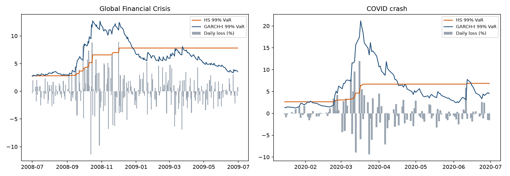
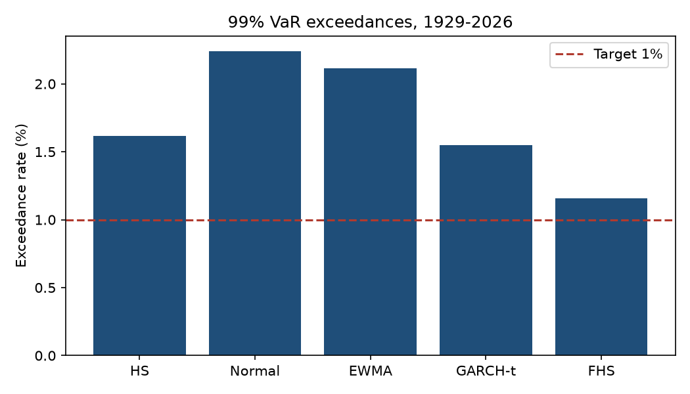

# VaR Model Validation Lab: 97 years of market crashes

Five Value-at-Risk / Expected Shortfall models, backtested out-of-sample on **25,338 trading days** of US equity market returns (Nov 1929 – Sep 2026), validated the way bank model-risk teams do it: coverage and independence tests, Basel traffic-light zones, an Expected Shortfall test, and crisis-by-crisis exceedances.



## Key findings
| Model | 99% VaR exceedances (target 1%) | 97.5% Kupiec p | Basel zone: green / yellow / red (% of days) | ES 97.5% test p |
|---|---|---|---|---|
| Historical simulation (250d) | 1.61% | 0.000 | 59.1 / 36.8 / 4.1 | 0.000 |
| Normal (250d) | 2.24% | 0.000 | 48.7 / 34.5 / **16.8** | 0.000 |
| EWMA (RiskMetrics, λ = 0.94) | 2.12% | 0.000 | 40.0 / 53.4 / 6.6 | 0.000 |
| GARCH(1,1)-t | 1.55% | 0.000 | 63.6 / 34.4 / 2.0 | 0.194 |
| **Filtered HS (GARCH-t filter)** | **1.16%** | **0.289** | **79.9 / 19.6 / 0.4** | **0.105** |

1. **Normal VaR fails.** It is breached more than twice as often as it should be, and sits in the Basel red zone 17% of the time: fat tails matter.
2. **Filtered historical simulation is the most reliable.** It is the only model whose 97.5% VaR passes the Kupiec coverage test, and it spends 80% of days in the green zone.
3. **Only the GARCH-based models pass the Expected Shortfall test** (the 97.5% ES measure used in FRTB). The others underestimate losses in the tail.
4. **Slow models break in fast crises.** In the COVID crash (52 trading days), historical simulation was breached 8 times, FHS once (expected: 0.5).
5. **No model is perfect.** All five show clustered exceedances over the century (Christoffersen p < 0.001), and even FHS is rejected at 99% (Kupiec p = 0.015): regime changes are hard to capture.

Full tables: [`results/results.md`](results/results.md) · crisis windows: [`results/crisis_exceedances.csv`](results/crisis_exceedances.csv)



## Method
- **Data:** daily US market return = Mkt-RF + RF from the Fama–French daily factors, Kenneth R. French Data Library (CRSP-based, Jul 1926 – Sep 2026). The file is not redistributed here; see *Reproduce*.
- **Forecasts:** 1-day VaR at 99% and 97.5% and ES at 97.5%, using only information up to the previous day. All models start on the same date (after a 1,000-day GARCH estimation window) so they are compared on identical days.
- **GARCH(1,1)-t:** estimated on a rolling 1,000-day window, refit every 21 trading days; variance updated daily with the latest parameters. FHS applies the empirical quantile of the GARCH standardised residuals.
- **Backtests:** Kupiec proportion-of-failures; Christoffersen independence; Basel traffic light on the trailing 250 days (green ≤ 4, yellow 5–9, red ≥ 10 exceedances at 99%); a McNeil–Frey-type ES test (one-sided t-test of loss − ES on 97.5% exceedance days).
- **Tests:** formulas checked against textbook values and a 2-million-draw Monte Carlo (`tests/`).

## Limitations
Single asset (US market index), not a bank trading book · 1-day horizon (Basel uses 10-day) · GARCH parameters frozen between monthly refits · ES test without bootstrap · pre-1952 data include Saturday trading sessions.

## Reproduce
```bash
python -m venv .venv && .venv/Scripts/pip install arch pandas numpy scipy matplotlib pytest
```
Download `F-F_Research_Data_Factors_daily_CSV.zip` from the [Kenneth R. French Data Library](https://mba.tuck.dartmouth.edu/pages/faculty/ken.french/data_library.html) into `data/ff_daily.zip`, then:
```bash
.venv/Scripts/python -m pytest -q && .venv/Scripts/python varlab.py
```
